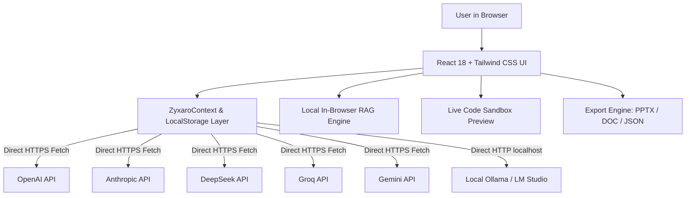
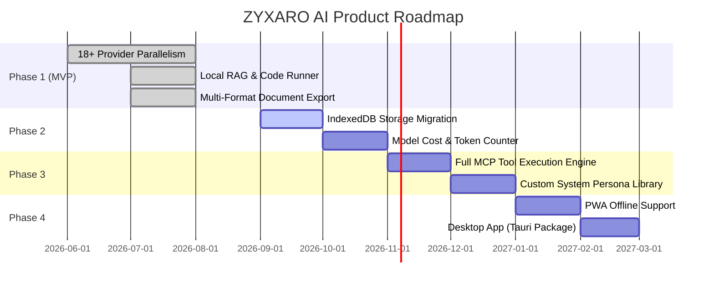

# Product Requirements Document (PRD)

**Product Name:** ZYXARO AI Stack  
**Product Version:** 1.0 (MVP)  
**Founder & CEO:** Chikoti Sai Vishal  
**Status:** Active / Production Ready  
**Date:** August 2026  

---

## 1. Executive Summary & Product Vision

### 1.1 Vision
**ZYXARO AI** is a privacy-first, zero-backend, local-first AI research assistant designed for students, software engineers, and researchers. It enables users to connect directly from their browser to **18+ AI providers** simultaneously, performing multi-model comparison, local document RAG (Retrieval-Augmented Generation), live code execution, and automated report generation—with **100% data sovereignty and zero server tracking**.

### 1.2 Problem Statement
- **Privacy Risks:** Centralized AI platforms store user prompts, proprietary source code, and API keys on remote servers, creating compliance and security vulnerabilities.
- **Vendor Lock-in & Inconsistent Quality:** Users often need to query multiple models (e.g., GPT-4o, Claude 3.5 Sonnet, DeepSeek R1, Groq Llama) to compare hallucinations, logic, or code implementations. Doing this across different browser tabs is tedious and slow.
- **High Latency & Middleware Overhead:** Traditional wrappers route requests through intermediate proxy servers, adding latency, potential outage points, and subscription markups.
- **Disconnected Research Workflows:** Exporting AI findings into actionable formats (PowerPoint slides, Word documents, research notes) requires manual copy-pasting and reformatting.

### 1.3 Value Proposition
- **Zero Backend / 100% Local-First:** Keys, chats, and documents reside solely in browser `localStorage`.
- **Parallel Multi-Model Concurrency:** One prompt queries up to 18 LLMs in parallel via `Promise.all`.
- **Sub-500ms Direct Connection:** Direct browser-to-API communication with no intermediary proxy lag.
- **Built-in Productivity Suite:** In-browser RAG parsing, live code runner, note-taking, and 1-click PowerPoint/Word/PDF export.

---

## 2. Target Personas & Core Use Cases

| Persona | Needs & Pain Points | How ZYXARO AI Solves It |
| :--- | :--- | :--- |
| **CS Students & Researchers** | Need to debug algorithms, understand complex theorems, and cite notes without losing context. | Provides step-by-step deep reasoning, side-by-side model diffing, and local PDF/notes synthesis. |
| **Software Engineers** | Need accurate code generation, memory leak audits, and instant runnable previews. | Compares multiple models simultaneously to eliminate hallucinations; live sandbox executes HTML/JSX/CSS code in real-time. |
| **Privacy-Conscious Analysts** | Work with proprietary briefs, contracts, and confidential notes. | 100% client-side parsing; zero data is dispatched to any ZYXARO server. |

---

## 3. MVP Scope Definition

The Minimum Viable Product (MVP) focuses on delivering a rock-solid, private, parallel AI engine with client-side document processing and multi-format export capabilities.

```
┌────────────────────────────────────────────────────────────────────────┐
│                          ZYXARO AI MVP SCOPE                           │
├──────────────────────────────────┬─────────────────────────────────────┤
│            IN SCOPE              │            OUT OF SCOPE             │
│            (MVP v1.0)            │            (Post-MVP)               │
├──────────────────────────────────┼─────────────────────────────────────┤
│  ✓ 18+ Direct AI Providers       │  ✗ Mandatory User Accounts/Login    │
│  ✓ Parallel Asynchronous Stream  │  ✗ Server-side Database (Postgres)  │
│  ✓ 100% localStorage Persistence │  ✗ Paid Subscription Billing/Stripe │
│  ✓ In-Browser RAG Document Chunk │  ✗ Server-side Video Rendering      │
│  ✓ Live Code Sandbox Runner      │  ✗ Desktop Packaging (Tauri/Native) │
│  ✓ Model Output Diff / Compare   │  ✗ Multi-user Team Workspaces       │
│  ✓ Export to PPTX, DOC, PDF, MD  │  ✗ Fine-tuning Pipeline             │
│  ✓ Dark Cyberpunk/Navy Design    │  ✗ Native Mobile App Store Release  │
└──────────────────────────────────┴─────────────────────────────────────┘
```

### 3.1 In-Scope (MVP Deliverables)
1. **Multi-Model Provider Engine:** Direct browser integration for OpenAI, Anthropic, DeepSeek, Groq, Mistral, OpenRouter, Gemini, Cohere, Together, Perplexity, xAI Grok, Ollama (Local), and Custom Endpoints.
2. **Parallel Dispatching:** Asynchronous simultaneous execution rendering individual response streams.
3. **Local Knowledge Base (RAG):** Drag-and-drop parsing of `.txt`, `.md`, `.json`, `.pdf` files into local chunks injected contextually into system prompts.
4. **Interactive Sandbox & Code Runner:** Live preview rendering for generated HTML, React/JSX, Tailwind, and JS code blocks.
5. **Research Document Exporter:** Automated client-side compilation of chat results into Microsoft PowerPoint (`.pptx` via `pptxgenjs`), Word (`.doc`), Markdown, and JSON.
6. **Local-First Data Layer:** Complete session management, pinned chats, notes, and encrypted keys saved to `localStorage`.
7. **Responsive & Futuristic UI:** Canvas starfield effects, Orbitron/Exo-2 typography, glassmorphism shortcuts, and dark-theme aesthetics.

### 3.2 Out-of-Scope (Deferred to Future Phases)
- Server-side database persistence (Supabase optional auth is available, but core app must function without backend).
- Payment gateways, credit tokens, or subscription paywalls.
- Desktop installers (Electron / Tauri native wrappers).
- Real-time team collaboration / shared multi-user canvas.

---

## 4. Functional Specifications & Features

### 4.1 Multi-Provider Concurrency
- **Requirement:** User selects one or more active providers in the Config panel.
- **Behavior:** On submitting a prompt:
  1. Input is validated and cleaned.
  2. If RAG is enabled, relevant document chunks are prepended as context.
  3. `Promise.allSettled` dispatches parallel HTTPS requests with the respective provider API key.
  4. Responses stream or resolve into dedicated cards with latency badges.

### 4.2 Local RAG Knowledge Base
- **Requirement:** Users can upload documents without sending files to an external embedding server.
- **Behavior:** Text is extracted and chunked locally into overlapping windows (e.g., 500-character segments). Relevant chunks are matched against prompt keywords and appended to the LLM system context.

### 4.3 Live Code Preview
- **Requirement:** Whenever an LLM responds with runnable HTML/JSX/CSS code blocks, the UI renders an inline executable preview toggle with console output inspection.

### 4.4 Multi-Format Export Suite
- **Requirement:** 1-click export of research sessions.
  - **PowerPoint (`.pptx`):** Generates structured slide decks with title slide, section dividers, bulleted takeaways, and dark navy master template.
  - **Word Document (`.doc`):** Generates clean, formatted documents with executive summaries.
  - **JSON:** Complete raw backup of sessions and notes for migration.

---

## 5. Non-Functional Requirements (NFRs)

### 5.1 Performance & Latency
- First Contentful Paint (FCP) < 1.0s.
- Time to Interactive (TTI) < 1.5s.
- Zero client-side memory leaks during multi-stream rendering.
- Code bundle size optimized with Vite chunk splitting.

### 5.2 Security & Privacy
- **Zero Intermediary Logging:** API keys are never transmitted to any third-party server other than the designated LLM provider.
- **Client-Side Key Masking:** Masked input fields with toggleable visibility in settings.
- **Instant Wipe:** 1-click data purging ("Burn All" / Reset) to instantly clear all `localStorage` keys and chats.

### 5.3 Reliability & Error Handling
- Graceful degradation: If one provider API times out or throws a rate-limit error (429), other concurrent providers continue streaming without crashing the application.
- Clear error tooltips explaining CORS or key validation errors.

---

## 6. Technical Stack & Architecture



- **Frontend:** React 18, TypeScript 5.9, Vite
- **Styling:** Tailwind CSS 4, Lucide Icons, Shadcn UI
- **Typography:** Orbitron, Exo 2, Inter
- **Document Generation:** `pptxgenjs` (PowerPoint), Blob Word/PDF exporters
- **State & Storage:** React Context API + Browser `localStorage`

---

## 7. Success Metrics & Key Performance Indicators (KPIs)

| Metric | Target Goal | Measurement Method |
| :--- | :--- | :--- |
| **Response Latency** | Sub-500ms to first token on fast providers (Groq/Gemini) | In-app latency stopwatch per card |
| **Export Reliability** | 100% valid PPTX/DOC generation without layout overflow | Automated validation & test fixtures |
| **Zero Data Leakage** | 0 outbound network requests to unauthorized servers | Browser Network tab inspection |
| **Crash Rate** | < 0.1% unhandled UI exceptions | React Error Boundaries |

---

## 8. Product Roadmap Beyond MVP



---

*Document Author: Chikoti Sai Vishal (Founder & CEO, ZYXARO AI Labs)*  
*Maintained with Antigravity (Google DeepMind)*
